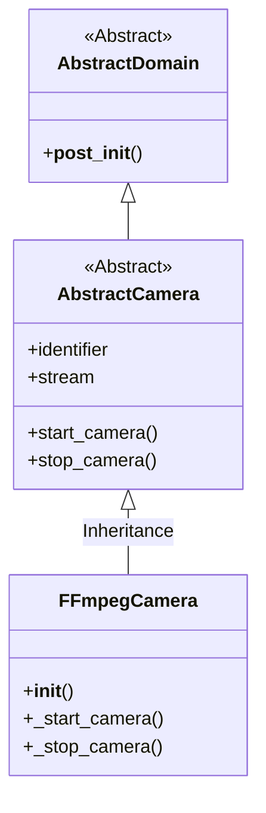
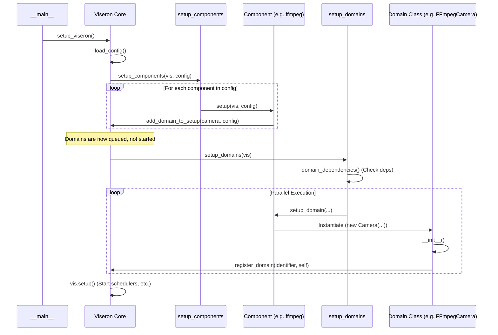

# Viseron 组件与域 (Component & Domain) 架构设计

本文档详细介绍了 Viseron 系统中的核心架构概念：**组件 (Component)** 和 **域 (Domain)**。我们将探讨它们的定义、相互关系、继承结构以及系统启动时的初始化控制流程。

## 1. 核心概念

### 1.1 组件 (Component)

组件是 Viseron 中的基础配置单元，通常对应于一个具体的集成（Integration）或功能模块。

- **职责**：负责解析配置、管理依赖，并初始化其下的一个或多个“域”。
- **代码位置**：`viseron/components/`
- **示例**：
  - `ffmpeg`: 负责处理视频流的核心组件。
  - `nvr`: 网络录像机逻辑组件。
  - `webserver`: 提供 Web 接口的组件。

### 1.2 域 (Domain)

域定义了某种功能类型的抽象接口。它代表了系统中的具体能力。

- **职责**：定义统一的操作接口（如 `AbstractCamera`, `AbstractObjectDetector`）。具体的功能实现由组件中的类来完成。
- **代码位置**：`viseron/domains/`
- **示例**：
  - `camera`: 摄像机域，定义了获取视频流、截图等行为。
  - `object_detector`: 目标检测域，定义了检测图像中物体的行为。

## 2. 组件与域的关系

组件和域之间主要存在 **工厂模式 (Factory Pattern)** 的关系。

1.  **配置驱动**：用户在 `config.yaml` 中配置组件（如 `ffmpeg`）。
2.  **实例化**：系统加载 `ffmpeg` 组件。
3.  **创建域**：`ffmpeg` 组件根据配置，实例化并注册一个或多个 `camera` 域的对象（例如 `FFmpegCamera`）。

简而言之：**组件是工厂，域是产品。**

## 3. 继承与组合关系

### 3.1 类继承结构

Viseron 使用抽象基类来强制执行接口契约。

- **Component**:
  - 基类：虽无显式的全局抽象基类，但所有组件需实现 `setup(vis, config)` 函数。
  - 通用逻辑：`viseron.components.Component` 类封装了组件的通用行为（如重试机制、配置校验）。

- **Domain**:
  - 基类：`viseron.domains.AbstractDomain`
  - 具体域基类：例如 `viseron.domains.camera.AbstractCamera` (继承自 `AbstractDomain`)。
  - 具体实现类：例如 `viseron.components.ffmpeg.camera.Camera` (继承自 `AbstractCamera`)。

**示例类图 (简化版)**:

### 3.2 组合关系 (Composition)

`Viseron` 核心类作为主要容器，组合了所有的组件和域。

- `vis.data[LOADING]`: 正在加载的组件。
- `vis.data[LOADED]`: 已加载的组件实例。
- `vis.data[REGISTERED_DOMAINS]`: 按类型存储的所有注册域（例如所有 `camera`）。

## 4. 初始化控制流程

系统启动主要由 `viseron/__init__.py` 中的 `setup_viseron` 函数驱动。

### 4.1 启动流程概览

1.  **加载配置**: `load_config()` 读取 `config.yaml`。
2.  **设置组件 (`setup_components`)**:
    - **日志组件**: 优先加载日志相关组件。
    - **核心组件**: 加载 `CORE_COMPONENTS` (如 `data_stream`)。
    - **默认组件**: 加载 `DEFAULT_COMPONENTS` (如 `webserver`, `storage`)。
    - **配置组件**: 根据 `config.yaml` 加载用户配置的组件。
3.  **组件初始化 (`setup_component`)**:
    - 调用组件模块的 `setup` 函数。
    - 组件解析配置，并调用 `add_domain_to_setup` 将其试图创建的域加入到待处理队列 (`vis.data[DOMAINS_TO_SETUP]`)。
    - **注意**: 此时域尚未真正实例化，只是注册了意图。
4.  **设置域 (`setup_domains`)**:
    - **依赖解析**: `domain_dependencies(vis)` 检查所有域的依赖关系是否满足。
    - **并发初始化**: 使用 `ThreadPoolExecutor` 并发地初始化所有等待的域。
    - **实例化**: 调用组件的具体方法（如 `ffmpeg.camera.setup`）来实例化域对象（如 `Camera` 对象）。
    - **注册**: 域对象初始化后，调用 `vis.register_domain` 将自己注册到系统中。

### 4.2 详细流程图

## 5. 总结

Viseron 的架构采用了高度模块化的设计：

- **组件**负责“管理”和“配置”。
- **域**负责“定义接口”和“规范行为”。
- **具体实现**由组件提供的类来完成，并继承自域的抽象基类。
- **两阶段初始化**（先 Setup Component，后 Setup Domain）确保了在真正启动业务逻辑前，所有配置和依赖都已就绪。
