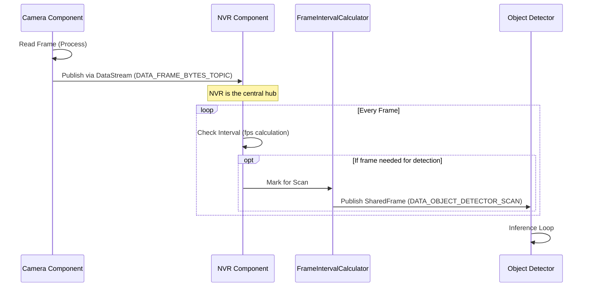

# Viseron 数据流架构 (Data Flow Architecture) 详解

本文档详细介绍了 Viseron 系统中组件之间的数据传递机制。Viseron 采用以 **NVR 组件** 为核心的星型数据分发模式，利用 `DataStream` 事件总线在不同组件（如 Camera、Object Detector）之间传递视频帧和检测结果。

## 1. 核心机制：DataStream

`DataStream` 是 Viseron 的核心事件总线，负责在组件之间传递消息。

- **发布 (Publish)**: 组件将数据发送到特定的 Topic（主题）。
- **订阅 (Subscribe)**: 组件监听特定的 Topic，当有新数据时触发回调。
- **实现**: 基于 `queue.Queue` 和线程分发，支持跨线程通信。

## 2. 视频帧流向 (Frame Data Flow)

视频帧从摄像头采集到最终被检测处理，经历了一个由 **NVR 组件** 协调的完整流程。

### 流程图

### 详细步骤

1.  **采集 (Source)**:
    - `Camera` 组件（运行在 Frame Reader 进程）读取原始流。
    - 通过 `_frame_queue` 传给主进程的 Relay 线程。
    - Relay 线程将帧封装为 `SharedFrame`（一种内存共享机制，避免大图片拷贝）。
    - **Topic**: `{camera_identifier}/camera/frame_bytes` (`DATA_FRAME_BYTES_TOPIC`)

2.  **协调 (Coordinator)**:
    - `NVR` 组件初始化时，订阅了上述 Topic。
    - 所有摄像头的帧都会先汇聚到对应的 `NVR` 实例中。
    - `NVR` 内部维护了多个 `FrameIntervalCalculator`（帧间隔计算器），分别对应 Object Detector、Motion Detector 等。

3.  **分发 (Forwarding)**:
    - 当 `NVR` 收到一帧时，它会询问 `FrameIntervalCalculator`：“这一帧需要送去检测吗？”
    - 计算器根据配置的 `fps`（检测帧率）决定是否处理。
    - 如果需要处理，`FrameIntervalCalculator` 会将该帧发布到检测器的 Topic。
    - **Topic**: `object_detector/{camera_identifier}/scan` (`DATA_OBJECT_DETECTOR_SCAN`)

4.  **消费 (Consumption)**:
    - `ObjectDetector` 组件订阅了 Scan Topic。
    - 它从队列中取出 `SharedFrame`，进行预处理和推理。

## 3. 检测结果流向 (Result Data Flow)

检测完成后，结果数据会回流到 NVR 组件，由 NVR 决定是否触发报警或录像。

### 详细步骤

1.  **推理完成**: `ObjectDetector` 完成目标检测，生成 `DetectedObject` 列表。
2.  **发布结果**:
    - 检测器将结果发布到结果 Topic。
    - **Topic**: `object_detector/{camera_identifier}/result` (`DATA_OBJECT_DETECTOR_RESULT`)
3.  **结果处理**:
    - `NVR` 组件（通过 `FrameIntervalCalculator` 的 `result_queue`）接收结果。
    - `NVR` 调用 `process_object_event` 方法。
4.  **决策与行动**:
    - `NVR` 检查检测到的对象是否在配置的 Zone 或 Mask 内。
    - 检查过滤条件（如置信度、标签）。
    - 如果满足条件，`NVR` 将 `TriggerTypes.OBJECT` 状态置为 True，触发 `start_recorder` 开始录像。

## 4. 事件输出 (Event Output)

除了内部逻辑流转，Viseron 还会将处理结果作为“事件”向外广播，供 Home Assistant、Web 前端或 MQTT 使用。

- **分发机制**: `vis.dispatch_event(event_name, data)`
- **常见事件**:
  - `EVENT_OBJECTS_IN_FOV`: 视野内检测到对象。
  - `EVENT_RECORDER_START`: 开始录像。
- **用途**: 这些事件不参与内部核心控制流（如是否录像），主要用于外部通知和状态展示。

## 5. 总结

Viseron 的数据流设计的关键点在于：**NVR 组件是绝对的控制中心**。

- Camera **只负责** 生产图片。
- Detector **只负责** 识别图片。
- **NVR** 负责决定 **何时** 把 图片 给 Detector，以及拿到结果后 **如何** 处理（录像/报警）。
  这种设计解耦了采集、处理和业务逻辑，使得系统极易扩展。
